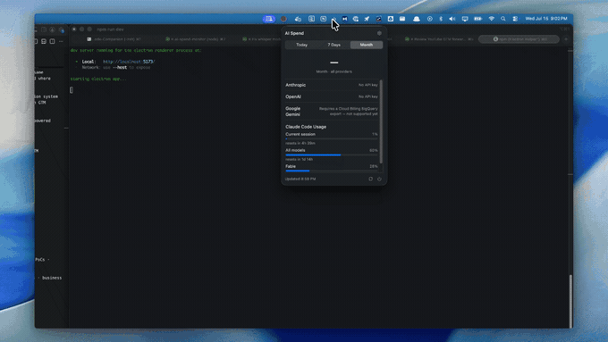

# AI Provider Spend

[English](README.md) | [简体中文](README.cn.md)

<p align="center"><em>一个小巧的 macOS 菜单栏应用，让你的 AI 花费和 Claude Code 套餐用量一键可见。</em></p>

<p align="center">
  
</p>

<p align="center">
  
  
  
  
</p>

## 这是什么

你是不是也和我一样，总是忍不住切换到 claude.ai 网页，就为了看看这次会话又用掉了多少额度？我做了这个工具，就是为了不用再这样来回切换。

AI Provider Spend 常驻在你的 macOS 菜单栏，回答两个原本需要打开三个不同后台才能知道的问题：

- **"我的 Claude Code 套餐用了多少？"** —— 一键即得，不用再开网页标签页。展示与 claude.ai 官方「设置 → 用量」页面完全一致的数据：当前 5 小时会话用量百分比、每周用量百分比、按模型区分的每周限额（例如某个特定模型的每周上限），以及各限额的重置倒计时。数据直接来自 Anthropic 的用量接口，使用 Claude Code 本地已有的登录信息获取，无需额外设置。
- **"这个月我在 AI API 上花了多少钱？"** —— 直接从各家提供商的 Admin API（Anthropic、OpenAI）或控制台（DeepSeek）拉取账单数据（Google Gemini 支持待 Cloud Billing 导出功能就绪后加入）。

所有信息都显示在菜单栏图标下方的轻量弹出窗口中。没有 Dock 图标，没有完整的应用窗口，也不需要注册任何账号 —— 数据就在你手边，触手可及。

## 下载

前往 [Releases 页面](https://github.com/justanotherkevin/ai-provider-spent/releases/latest)下载最新版本，选择与你的 Mac 匹配的 `.dmg` 文件：

- **Apple 芯片**（M1/M2/M3/M4）—— `ai-provider-spent-*-arm64.dmg`
- **Intel 芯片** —— `ai-provider-spent-*-x64.dmg`

> **提示：** 目前的构建版本未经 Apple 开发者证书签名和公证。macOS 会提示应用「来自身份不明的开发者，无法打开」。在「访达」的应用程序文件夹中右键（或按住 Control 点击）该应用 → 选择「打开」→ 确认即可，只需操作一次。

## 支持这个项目

也被那个「身份不明的开发者」警告烦到了？我也是。差一个每年 99 美元的 Apple 开发者账号，这个警告就能彻底消失。如果这个应用帮你省下了来回切换网页查用量的麻烦，欢迎[请我喝杯咖啡](https://buymeacoffee.com/justanotherkevin) —— 众筹到 100 美元后，我就去开通 Apple 开发者账号，发布经过签名和公证的版本，让这个警告彻底消失。

<p align="center">
  <a href="https://buymeacoffee.com/justanotherkevin"></a>
</p>

## 功能特性

| 功能                       | 说明                                                                                                 |
| -------------------------- | ---------------------------------------------------------------------------------------------------- |
| **多提供商花费统计**       | 支持今日 / 近 7 天 / 本月三种视图，覆盖 Anthropic、OpenAI、DeepSeek，以及（即将支持的）Google Gemini |
| **Claude Code 套餐用量**   | 真实的会话用量百分比、每周用量百分比、按模型限额，以及用量额度花费 —— 并非估算值                     |
| **菜单栏标题显示**         | 无需打开弹出窗口，菜单栏图标旁即可看到本月至今的花费总额                                             |
| **加密密钥存储**           | Admin API 密钥和控制台令牌通过 macOS 钥匙串（Electron `safeStorage`）加密存储                        |
| **Claude Code 用量零配置** | 只要 Claude Code 已在你的电脑上登录，用量追踪即可直接使用                                            |

## 从源码运行

想自己构建而不是下载 `.dmg`？

```bash
# 克隆仓库
git clone https://github.com/justanotherkevin/ai-provider-spent.git
cd ai-provider-spent

# 安装依赖
npm install

# 以开发模式启动应用
npm run dev
```

应用会以图标形式出现在菜单栏中 —— 点击图标即可打开弹出窗口。

### 配置

在弹出窗口中点击设置图标（齿轮），添加各提供商的密钥或令牌：

| 提供商        | 密钥获取地址                                                                                                                                                                                                                 |
| ------------- | ---------------------------------------------------------------------------------------------------------------------------------------------------------------------------------------------------------------------------- |
| Anthropic     | [console.anthropic.com/settings/admin-keys](https://console.anthropic.com/settings/admin-keys) —— 需要组织级 Admin 密钥，普通 API 密钥不可用                                                                                 |
| OpenAI        | [platform.openai.com](https://platform.openai.com) —— 组织级 Admin 密钥                                                                                                                                                      |
| DeepSeek      | 你的控制台令牌。在浏览器中登录 [platform.deepseek.com](https://platform.deepseek.com)，打开开发者工具控制台，运行 `copy(JSON.parse(localStorage.userToken).value)`，然后粘贴结果。令牌可能会过期，届时应用会提示你重新输入。 |
| Google Gemini | 暂不支持 —— 需要 Cloud Billing 的 BigQuery 导出功能                                                                                                                                                                          |

DeepSeek 没有官方的花费 API，所以应用会用你的控制台令牌，从 DeepSeek 用量页面所使用的同一个内部接口读取每日费用。DeepSeek 可能随时更改这个接口，令牌也可能过期，因此在你粘贴新令牌或更新应用之前，DeepSeek 一行可能会显示错误。每天按 UTC 时间计算，所以每日数字可能和控制台略有差异，因为控制台使用的是你的本地时区。

Claude Code 套餐用量无需任何密钥 —— 只要你已通过 `claude` 命令登录，应用会直接读取 Claude Code 本地已保存的 OAuth 令牌（macOS 上存于钥匙串，其他平台存于 `~/.claude/.credentials.json`）。

## 打包构建

```bash
npm run build:mac      # macOS
npm run build:win      # Windows
npm run build:linux    # Linux
```

构建产物输出至 `dist/` 目录。

## 技术栈

基于 [Electron](https://www.electronjs.org)、[React](https://react.dev)、[TypeScript](https://www.typescriptlang.org) 和 [Vite](https://electron-vite.org) 构建，并使用经 [Zod](https://zod.dev) 校验的类型安全 IPC 层（"Conveyor"）。脚手架来自 [guasam/electron-react-app](https://github.com/guasam/electron-react-app)。

## 许可证

[MIT](LICENSE)
